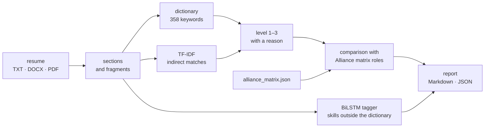

# CV Skills Extractor, version 2: Matching a Resume to the Competency Matrix

[Русская версия](README.md)

The second version of the project, November 2026. It solves the original case task, "A system for automated analysis of how IT specialists' competencies match market requirements". From a resume it determines:
- which competencies of the Alliance matrix are confirmed and at what level;
- what is missing for a role;
- which of the four roles fits.

The first version is in the repository root.

## What it does

- **Reads resumes** in TXT, DOCX and PDF and splits them into sections: objective, skills, experience, projects, education, certificates.
- **Finds all 34 competencies of the matrix.** The main method is a dictionary of 358 Russian and English keywords that handles Russian inflection ("машинному обучению" = "машинное обучение"). When there are no keywords, a competency is found indirectly, by similar wording (TF-IDF over character n-grams).
- **Estimates the level from 1 to 3 and explains it.** A skill from the list gives "Basic", use in work experience or projects gives "Advanced", and use together with leading people or a prize gives "Expert". The objective and the resume header do not count as evidence.
- **Compares the resume with each of the 4 roles.**
  - Splits competencies into confirmed, below the required level and missing.
  - Computes coverage and detects the desired role from the resume objective.
  - Marks competencies of the chosen industry, such as oil and gas, with ★.
- **Finds skills outside the dictionary.** A BiLSTM tagger does this; in the example below it found "Data Science".
- **Produces a report** in Markdown for a recruiter and in JSON for integration with other systems.



## Example

```bash
python -m competency_match ../data/sample_resume.txt --industry Нефтегазовая
```

Role ranking for the test (fictional) resume of a data analyst with 2 years of experience:

| Role | Coverage | Confirmed | Below level | Missing |
|---|---|---|---|---|
| Technical analyst in AI (`TA_AI`) | 60% | 9 | 0 | 6 |
| Manager in AI (`MGR_AI`) | 54% | 7 | 0 | 6 |
| Data scientist, ML engineer (`DS_ML`), the resume objective | 41% | 6 | 6 | 10 |
| Data engineer (`DE`) | 38% | 5 | 7 | 10 |

Coverage is the sum of min(estimate, required level) divided by the sum of required levels. For the role from the resume objective, the report shows, for example:
- machine learning methods are confirmed at the advanced level thanks to a top-10% Kaggle result;
- Python, TensorFlow and computer vision appear only in the skills list and are worth checking in an interview;
- for the oil and gas industry, the main gaps are optimization methods and deep learning.

The full report is in [examples/sample_report.md](examples/sample_report.md) (in Russian), and the same report in JSON is in [examples/sample_report.json](examples/sample_report.json).

## What is new in version 2

- a `competency_match` package with a command line instead of a notebook;
- a level from 1 to 3 for every competency with an explanation, compared with the level each of the four roles requires, plus role coverage and ranking;
- the desired role from the resume objective and markers for the chosen industry's competencies;
- a BiLSTM tagger with a character CNN: masked padding, 4000 training sentences, a check on unseen skills, and its findings go into the report;
- a report in Markdown and JSON, 24 tests.

## Tagger quality

| Check | Precision | Recall | F1 |
|---|---|---|---|
| Sentences with known skills | 1.000 | 1.000 | 1.000 |
| Sentences with 90 skills not seen in training | 0.956 | 0.958 | 0.957 |

Training and test sentences are built from resume templates and dictionary keywords. On the test resume the tagger finds skills that are not in the dictionary, such as "Data Science". All metrics are in [results/tagger_metrics.json](results/tagger_metrics.json).

## Layout

| Module | What it does |
|---|---|
| `competency_match/matrix.py` | Loads the matrix: roles, competencies, required levels, industries |
| `competency_match/text.py` | Reads TXT, DOCX and PDF; resume sections, fragments, tokenization with light stemming, years of experience |
| `competency_match/aliases.json` | Keywords for the 34 competencies |
| `competency_match/extract.py` | Dictionary search (longest match wins, case-sensitive acronyms) and indirect TF-IDF matches |
| `competency_match/levels.py` | Level rules with explanations |
| `competency_match/assess.py` | Role comparison, coverage, ranking, the desired role from the resume objective |
| `competency_match/tagger.py` | The BiLSTM tagger: word embeddings, a character CNN and spelling features. Training sentence generation, training, entity-level F1 |
| `competency_match/report.py` | The Markdown and JSON report |
| `scripts/train_tagger.py` | Trains the tagger and computes the metrics |

## Quick start

```bash
cd v2
pip install -r requirements.txt
python -m competency_match ../data/sample_resume.txt --role DS_ML --industry Нефтегазовая
python -m competency_match resume.docx --format json --out report.json
python -m pytest
```

The trained tagger is in `models/skill_tagger.pt` (560 KB) and is picked up automatically. To retrain it, run `python scripts/train_tagger.py`; it takes about a minute on a CPU.

## Tech stack

Python, PyTorch (BiLSTM, character CNN), scikit-learn (TF-IDF), python-docx, pypdf, pytest.

## License

[MIT](../LICENSE)
