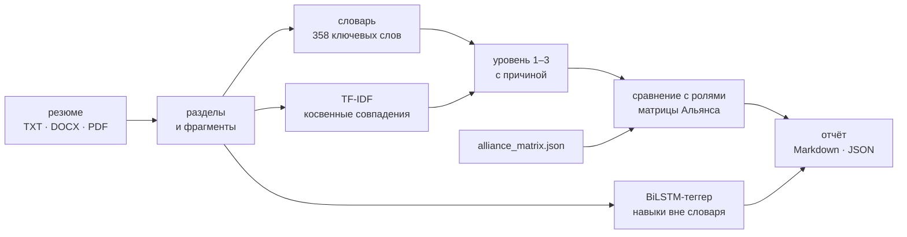

# CV Skills Extractor, версия 2: соответствие резюме матрице компетенций

[English version](README.en.md)

Вторая версия проекта, ноябрь 2026. Она решает исходную задачу кейса «Система автоматизированного анализа соответствия компетенций IT-специалистов требованиям рынка». По резюме нужно определить:
- какие компетенции матрицы Альянса подтверждены и на каком уровне;
- чего не хватает для роли;
- какая из четырёх ролей подходит.

Первая версия лежит в корне репозитория.

## Что умеет

- **Читает резюме** в форматах TXT, DOCX и PDF и делит его на разделы: цель, навыки, опыт, проекты, образование, сертификаты.
- **Находит все 34 компетенции матрицы.** Основной способ — словарь из 358 ключевых слов на русском и английском с учётом падежей («машинному обучению» = «машинное обучение»). Если ключевых слов нет, компетенция ищется косвенно, по сходству формулировок (TF-IDF по символьным n-граммам).
- **Оценивает уровень от 1 до 3 и объясняет оценку.** Навык из списка даёт «Базовый», применение в опыте или проектах — «Продвинутый», вместе с руководством или призовым местом — «Экспертный». Цель и шапка резюме подтверждением не считаются.
- **Сравнивает резюме с каждой из 4 ролей.**
  - Делит компетенции на подтверждённые, те, что ниже требуемого уровня, и не найденные.
  - Считает покрытие и узнаёт желаемую роль из цели резюме.
  - Отмечает ★ компетенции выбранной отрасли, например нефтегазовой.
- **Ищет навыки вне словаря.** Это делает BiLSTM-теггер: в примере ниже он нашёл «Data Science».
- **Выдаёт отчёт** в Markdown для рекрутера и в JSON для интеграции с другими системами.



## Пример

```bash
python -m competency_match ../data/sample_resume.txt --industry Нефтегазовая
```

Рейтинг ролей для тестового (вымышленного) резюме аналитика данных со стажем 2 года:

| Роль | Покрытие | Подтверждено | Ниже уровня | Не найдено |
|---|---|---|---|---|
| Технический аналитик в ии (`TA_AI`) | 60% | 9 | 0 | 6 |
| Менеджер в ии (`MGR_AI`) | 54% | 7 | 0 | 6 |
| Аналитик данных (`DS_ML`), цель резюме | 41% | 6 | 6 | 10 |
| Инженер данных (`DE`) | 38% | 5 | 7 | 10 |

Покрытие — это сумма min(оценка, требуемый уровень), делённая на сумму требуемых уровней. Для роли из цели резюме отчёт показывает, например:
- методы машинного обучения подтверждены на продвинутом уровне благодаря ТОП-10% в соревновании на Kaggle;
- Python, TensorFlow и компьютерное зрение указаны только в списке навыков, их стоит уточнить на собеседовании;
- для нефтегазовой отрасли прежде всего не хватает методов оптимизации и глубокого обучения.

Полный отчёт лежит в [examples/sample_report.md](examples/sample_report.md), тот же отчёт в JSON — в [examples/sample_report.json](examples/sample_report.json).

## Что нового во второй версии

- пакет `competency_match` с командной строкой вместо ноутбука;
- уровень каждой компетенции от 1 до 3 с объяснением и сравнение с требуемым уровнем для всех четырёх ролей, покрытие и рейтинг ролей;
- желаемая роль из цели резюме и отметка компетенций выбранной отрасли;
- BiLSTM-теггер с символьной свёрткой: маскировка отступов, 4000 обучающих предложений, проверка на незнакомых навыках, находки теггера входят в отчёт;
- отчёт в Markdown и JSON, 24 теста.

## Качество теггера

| Проверка | Точность | Полнота | F1 |
|---|---|---|---|
| Предложения со знакомыми навыками | 1.000 | 1.000 | 1.000 |
| Предложения с 90 навыками, которых не было в обучении | 0.956 | 0.958 | 0.957 |

Обучающие и проверочные предложения собраны из шаблонов резюме и ключевых слов словаря. На тестовом резюме теггер находит навыки, которых нет в словаре, например «Data Science». Все метрики лежат в [results/tagger_metrics.json](results/tagger_metrics.json).

## Как устроено

| Модуль | Что делает |
|---|---|
| `competency_match/matrix.py` | Загрузка матрицы: роли, компетенции, требуемые уровни, отрасли |
| `competency_match/text.py` | Чтение TXT, DOCX и PDF, разделы резюме, фрагменты, токенизация с лёгким стеммингом, стаж по годам |
| `competency_match/aliases.json` | Ключевые слова для 34 компетенций |
| `competency_match/extract.py` | Поиск по словарю (самое длинное совпадение, аббревиатуры с учётом регистра) и косвенные совпадения по TF-IDF |
| `competency_match/levels.py` | Правила оценки уровня с объяснением |
| `competency_match/assess.py` | Сравнение с ролями, покрытие, рейтинг, желаемая роль из цели резюме |
| `competency_match/tagger.py` | BiLSTM-теггер: эмбеддинги слов, свёртка по символам, признаки написания. Генерация обучающих предложений, обучение, метрика F1 по сущностям |
| `competency_match/report.py` | Отчёт в Markdown и JSON |
| `scripts/train_tagger.py` | Обучение теггера и подсчёт метрик |

## Запуск

```bash
cd v2
pip install -r requirements.txt
python -m competency_match ../data/sample_resume.txt --role DS_ML --industry Нефтегазовая
python -m competency_match резюме.docx --format json --out report.json
python -m pytest
```

Обученный теггер лежит в `models/skill_tagger.pt` (560 КБ) и подключается автоматически. Переобучить его можно командой `python scripts/train_tagger.py`, это около минуты на CPU.

## Стек

Python, PyTorch (BiLSTM, свёртка по символам), scikit-learn (TF-IDF), python-docx, pypdf, pytest.

## Лицензия

[MIT](../LICENSE)
